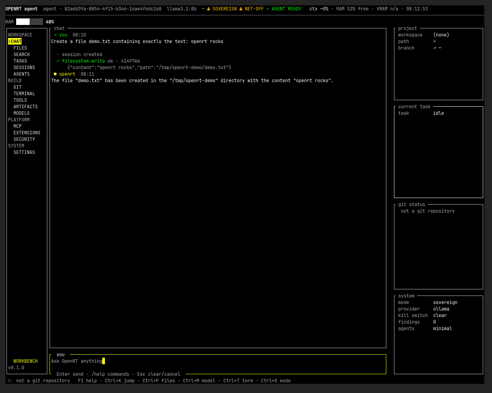
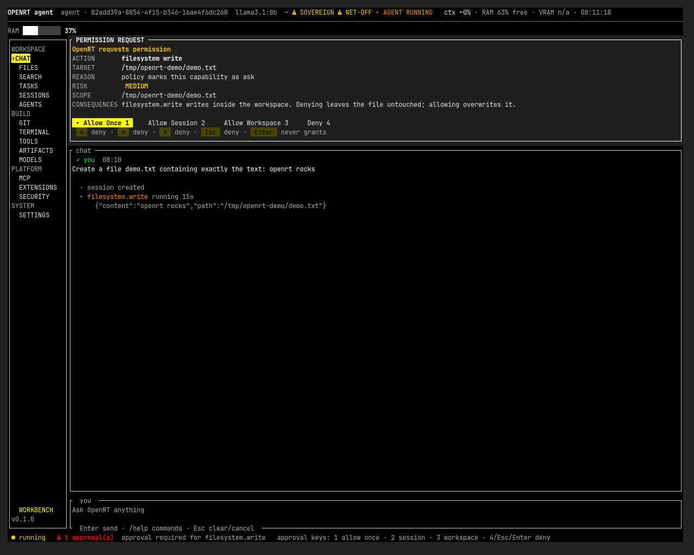
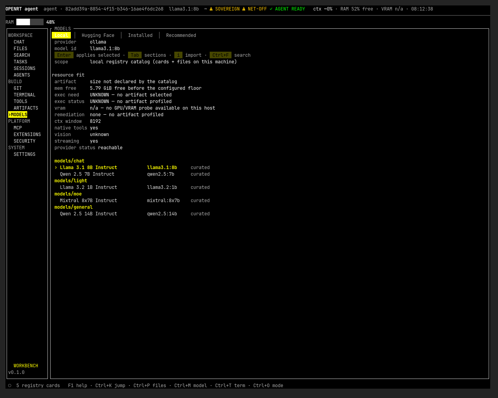
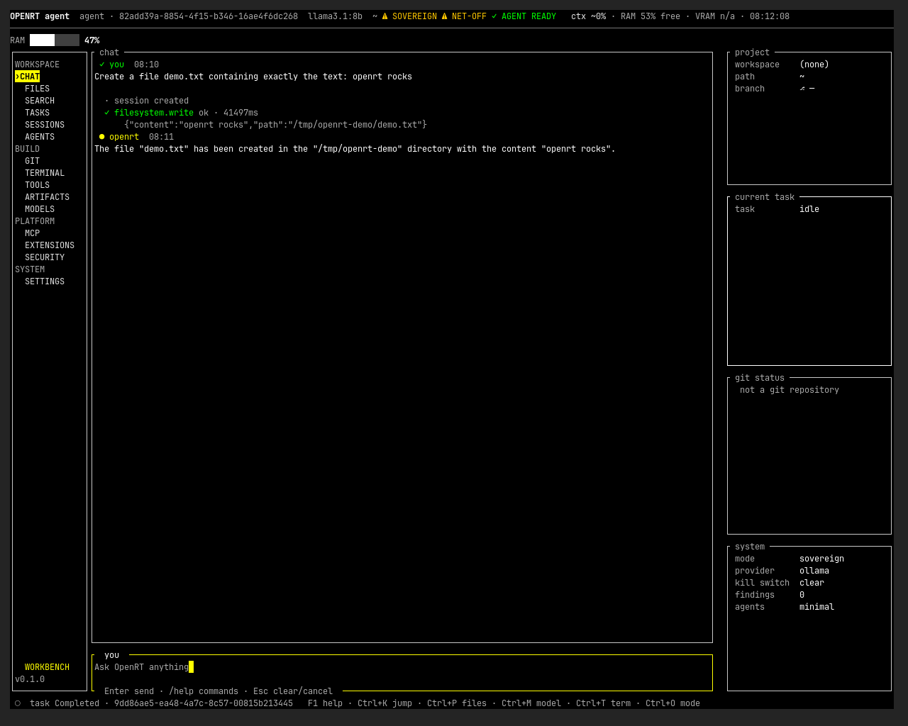
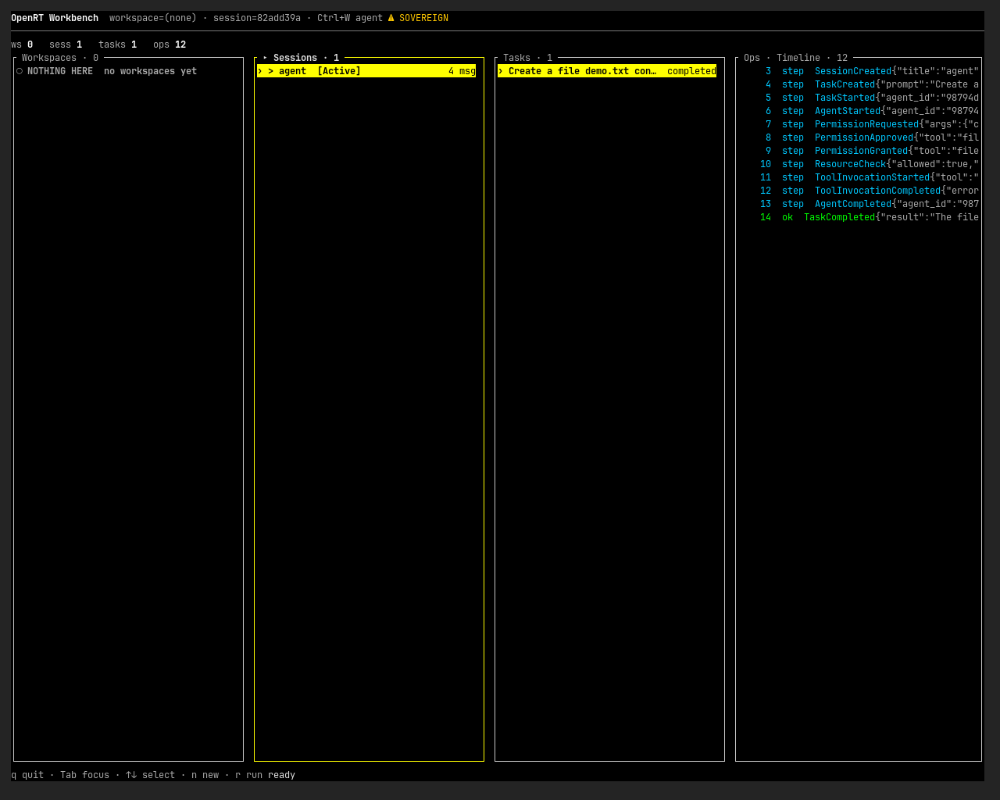
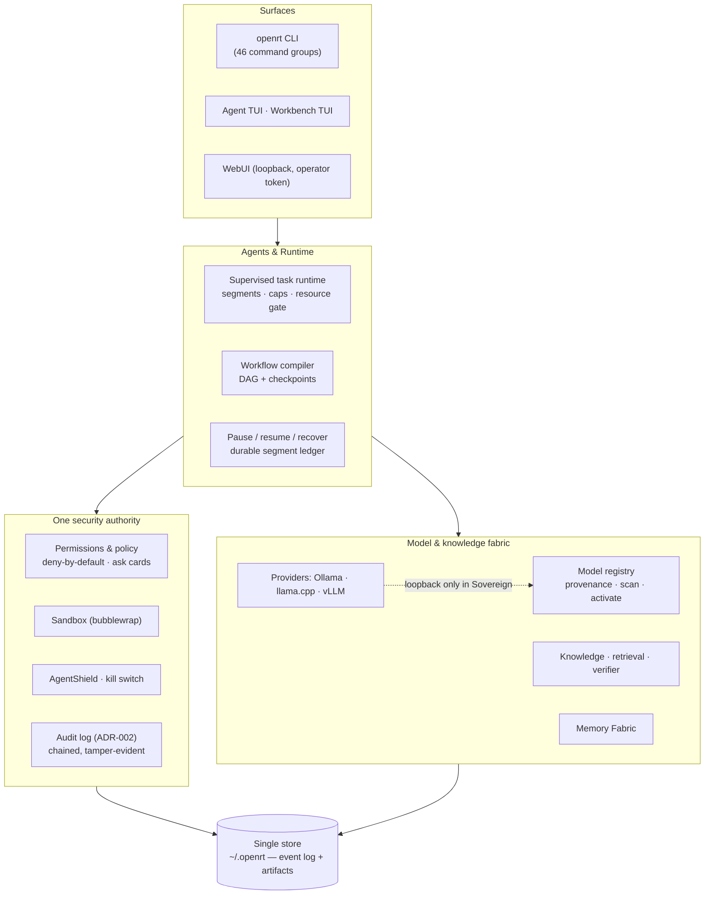

# OpenRT

**A sovereign, local-first agentic AI runtime for Linux.**
One store. One gate. One audit chain — agents, tools, knowledge, workflows,
sandboxed execution, and verification, all on your machine.

```
OpenRT V1 · v0.1.0 · MIT · Linux x86_64
Status: V1 archived/reference release — frozen; OpenRT V2 is planned separately.
```

> **What this is.** A complete, self-contained agentic runtime that treats
> your hardware as the only trust boundary: model weights stay local
> (Ollama / llama.cpp / vLLM on loopback), every capability passes one
> deny-by-default permission gate, every action lands in a tamper-evident
> audit chain, and the system says `UNAVAILABLE` instead of faking green.

---

## Screenshots

Real captures of the running application on the development host
(Agent Mode TUI, real local Ollama provider, first-run setup completed live).

**Main chat — a completed tool-use task with live status rails**



**Permission gate — the model asked for a file write; the operator decides**



**Models — provider probe + resource-fit honesty + curated catalog**



**Task completion — tool result, agent answer, audit-linked status bar**



**Workbench — sessions, tasks, and the live Ops event timeline**



---

## Problem statement

Local AI tooling is fragmented: a model server here, a chat client there, a
pile of shell scripts wired to tools with no permission model, no audit
trail, no recovery when the machine or process dies. Teams that need
on-premise autonomy — labs, factories, air-gapped environments — end up
reassembling the same fragile stack and trusting it with real access to
files, browsers, and data.

**Goal:** one runtime where model management, agent execution, tool access,
knowledge, verification, and recovery are a single audited system with a
single security authority — usable offline, inspectable end to end.

## Key features

Validation tiers used below: **[I]** implemented · **[M]** tested with the
mock/deterministic harness · **[R]** verified against a real local provider
(Ollama, on this host) · **[E]** experimental · **[N]** not validated (see
[Known limitations](#known-limitations)).

| Area | What you get | Tier |
|---|---|---|
| **Agent runtime** | Multi-segment supervised tasks, wall-clock/iteration caps, resource-gated admission, cooperative pause/resume, durable segment checkpoints, crash recovery (`task resume` / `task recover`) | [M] [R] |
| **Tool calling** | Native provider tool schemas (Ollama), canonical tool-call parsing, ask/allow/deny permission cards scoped once / per-session / per-workspace | [M] [R] |
| **Model fabric** | Registry with SHA-256 provenance (ADR-001), curated offline library, install → scan → activate lifecycle, live provider probes, honest capability rows | [M] [R] |
| **Sandbox & security** | Bubblewrap-backed sandbox authority, AgentShield detectors, kill switch (ADR-008), encrypted secrets at rest, default-deny egress (netpol), tamper-evident audit log (ADR-002) | [M] |
| **Knowledge / RAG** | Content-inspected ingest, hybrid BM25+dense retrieval with citations, evidence graph with trust labels, injection detection, hallucination firewall — answers fail closed | [M] |
| **Workflows** | Natural-language goal → compiled DAG, checkpoints after every durable node, resume/retry/skip/dry-run recovery plans | [M] |
| **Surfaces** | Agent TUI (chat-first), Workbench TUI (sessions/tasks/ops), loopback WebUI with operator token, full CLI | [M] |
| **Sovereignty** | Sovereign mode fail-closes external network at every scope (browser, DB, MCP, **models**, telemetry); loopback + files stay local; every refusal is audited with a fix hint (ADR-003) | [M] [R] |
| **Domains** | Industrial intelligence (advisory RCA/FMEA) and research-only trading backtests — `execute` always refuses; no order path exists | [M] |
| **SIH hero demo** | `openrt sih demo --json` — hermetic synthetic cyber-case through ingest → graph → retrieval → workflow → verification, five deterministic artifacts | [M] |
| **Streaming responses** | Token streaming implemented for the Ollama provider | [N] |
| **Context compaction** | Request-budget guard + compaction marker implemented in the agent request path | [N] |

## Architecture



Design invariants (held across every phase):

1. **One store** — sessions, tasks, registry, audit, knowledge all hang off a
   single event-log store (ADR-006: references + digests, never copies).
2. **One gate** — every tool, browser, DB, MCP, and computer-use call passes
   the same deny-by-default permission authority.
3. **One audit chain** — append-only, hash-chained, verifiable
   (`openrt audit verify`).
4. **Honest failure** — capabilities that cannot be probed report
   `UNAVAILABLE`; the runtime never invents a greener second answer.

## Crates

64 workspace crates, ~400 Rust source files, 403 pinned dependencies
(`Cargo.lock`, supply-chain verified by `openrt doctor`). Highlights:

| Component | Crates | Responsibility |
|---|---|---|
| Core | `openrt-core` `openrt-config` `openrt-telemetry` `openrt-persistence` `openrt-audit` | config validation, events, store, redaction, audit chain |
| Runtime | `openrt-runtime` `openrt-agents` `openrt-orch` `openrt-sched` `openrt-checkpoint` `openrt-supervisor` | task segments, agent loop, workflows, recovery |
| Models | `openrt-models` `openrt-registry` `openrt-scan` `openrt-model-cache` `openrt-router` `openrt-provider-llamacpp` `openrt-provider-vllm` | provider transports, artifact lifecycle, routing |
| Security | `openrt-permissions` `openrt-policy` `openrt-sandbox` `openrt-shield` `openrt-safety` `openrt-secrets` `openrt-netpol` `openrt-enclave` | the single gate, sandbox, detectors, secrets, egress |
| Knowledge | `openrt-knowledge` `openrt-retrieval` `openrt-evidence` `openrt-verifier` `openrt-ingest` `openrt-embeddings` `openrt-memory` | RAG, evidence graph, firewall, Memory Fabric |
| Tools | `openrt-tools` `openrt-mcp` `openrt-browser` `openrt-computer` `openrt-database` `openrt-office` | tool fabric, MCP registry, browser/computer-use |
| Surfaces | `openrt-cli` `openrt-tui` `openrt-webui` | the three front doors |
| Domains | `openrt-industrial` `openrt-trading` `openrt-selfimprove` | advisory intelligence, research-only backtests, gated self-improvement |

Full allocation map: [`docs/architecture/OWNERSHIP.md`](docs/architecture/OWNERSHIP.md).

## Installation

Prerequisites (verified on the development host):

- **Linux x86_64** (glibc). Windows/macOS: untested, no claim made.
- **Rust 1.89+** (workspace `rust-version = "1.89"`).
- Optional, for full capability: [Ollama](https://ollama.com) on loopback
  (real provider), `bubblewrap` (sandbox), `nvidia-smi` (VRAM probes),
  LibreOffice `soffice` (PDF export), `foot` or any modern terminal for the TUIs.

```console
$ git clone https://github.com/0xhroot/openrt.git
$ cd openrt
$ cargo build --release
$ ./target/release/openrt --version
openrt 0.1.0
```

Offline builds work too once the cargo cache is primed
(`cargo build --release --offline`) — the workspace itself needs no network.

## Configuration and Ollama setup

OpenRT keeps all state under `~/.openrt` (store, registry, audit, sessions).
Global flags override without editing files:

| Flag | Effect |
|---|---|
| `--memory` | in-memory store, nothing written to `~/.openrt` |
| `--mock` | deterministic mock provider (offline demos, tests) |
| `--log debug` | log level |

For a real provider, install Ollama and pull any chat model:

```console
$ ollama pull llama3.1:8b        # or any local chat model
$ ./target/release/openrt model list
```

The first Agent TUI run opens a **first-run setup wizard** that probes the
provider live (real transport call), shows the advertised tool schema and
context window, and binds a model — origin, tag, and native-tool support are
shown before anything is persisted (see the Models screenshot above).
Config knobs (context guard ratio, idle timeout, task caps, resource floors)
live in the generated config and are validated on load — invalid values are
rejected, not ignored.

## Running

```console
$ openrt                 # Agent TUI (chat-first) — same as `openrt agent`
$ openrt tui             # Workbench TUI: workspaces · sessions · tasks · ops
$ openrt webui serve     # loopback-only web workbench (one-time operator token)
$ openrt doctor          # honest posture report: PASS / WARN / UNAVAILABLE
$ openrt mode status     # Sovereign / Provisioning (ADR-003)
$ openrt task            # run a headless task against an agent
$ openrt sih demo --json # hermetic SIH hero demo (~1 s, mock backend)
```

## Models: discovery, registration, binding

Three distinct concepts — OpenRT never conflates them:

1. **Discovery** — `openrt model search` walks the curated offline library +
   installed registry. `--hf` queries Hugging Face and is refused before any
   socket in Sovereign mode (Provisioning-only network op).
2. **Registration** — `openrt model register <path>` records a local artifact
   **by reference**: streams its SHA-256, inspects the header, stores a path —
   never copies a byte. `openrt model install` imports, verifies, publishes
   the immutable manifest (ADR-001), and runs the scan gate.
3. **Binding** — activating a scanned artifact (`Scanned → Active`) makes it
   routable; the **provider tag** (`llama3.1:8b`) is a separate, displayed
   field. Artifact identity (sha256), registry card, provider, and tag are
   four different things and the UI keeps them apart.

Lifecycle: `Registered → Installed → Scanned → Active`, with signed offline
scan bundles and operator-only transitions.

## Agents, tools, permissions, recovery

- **Execution model** — a task is a sequence of supervised agent segments
  against one session. Every segment is checkpointed durably; turn state
  inside a segment is working state. Iteration, wall-clock, tool-call, and
  turn caps are enforced by the supervisor.
- **Resource gate** — before admission, the runtime probes real headroom
  (RAM, VRAM via `nvidia-smi`, CPU load) against configured floors; tight
  systems get bounded retries then a structured denial — never an OOM by
  surprise.
- **Permissions** — tools declare capabilities; policy maps each to
  `allow` / `ask` / `deny` / hidden. `ask` renders an operator card with
  scope choices: once, this session, this workspace. Deny leaves the world
  untouched; the model is told, honestly.
- **Sandbox** — `python.run` and friends execute confined (bubblewrap),
  workspace-jailed, shield-scanned.
- **Pause / resume / recover** — cooperative, in-process pause writes a
  durable `Paused` segment outcome; resume continues from the ledger.
  After a crash or restart, `openrt task` recovery re-enters the supervisor
  from the last durable segment — transcripts are never re-run from scratch.
- **Kill switch** — operator halt (ADR-008) is audited and immediate.

## Testing and validation

All gates were run manually on the development host (no CI is configured —
see limitations). Latest evidence, 2026-10-10:

```console
$ cargo fmt --all -- --check          # clean
$ cargo check --offline --workspace   # ok
$ cargo clippy --workspace --all-targets --offline
                                      # ok — 10 pre-existing warnings (openrt-cli)
$ cargo test --offline --workspace
                                      # 2590 passed · 0 failed
$ openrt doctor
                                      # 86 PASS · 13 UNAVAILABLE · 0 FAIL · 2 WARN
```

Real-provider verification (Ollama on loopback) this cycle:

- multi-segment supervised task with native tool call → permission card →
  tool execution → completion (screenshots above);
- live pause → durable `Paused` → resume → completion, transcript preserved
  (integration test `real_ollama_pause_then_resume_preserves_transcript`);
- provider probe, tool-schema advertisement, VRAM/RAM admission probes.

Per-phase acceptance records (test matrices, red-team results, measured
performance): [`docs/`](docs/README.md).

## Known limitations

Stated plainly, because a green checkmark you can't audit is worthless:

- **Streaming** — the Ollama streaming path is implemented but **not
  validated** end-to-end; under some conditions a stream can end without a
  terminal `done` frame and the client surfaces an honest error instead of
  pretending the answer completed. Non-streaming paths are fully validated.
- **Context compaction** — the budget guard and compaction marker are
  implemented and unit-tested; live compaction against a real provider was
  **not demonstrated** in this cycle (the guard correctly refuses when a
  single request alone exceeds budget).
- **No CI** — every gate above was run by hand on one Linux host and recorded
  in the docs. Reproduce them; don't trust them blindly.
- **Linux x86_64 only** — sandbox and computer-use paths are
  Linux-specific (Wayland/Hyprland backend exercised). No Windows/macOS
  claim.
- **Some probes are honestly `UNAVAILABLE`** — e.g. `verifier.model` without
  a configured default model, audio transcript extraction without whisper.
  `openrt doctor` is the posture authority; nothing is faked green.
- **Domain modules are advisory/research** — trading has no broker and no
  order path (`execute` refuses by design); industrial outputs are advisory.

## Repository structure

```
openrt/
├── Cargo.toml              # workspace: 64 crates, rust-version 1.89
├── LICENSE                 # MIT
├── README.md
├── crates/                 # all source (core → runtime → fabric → surfaces)
│   ├── openrt-core/        # config, events, store, redaction
│   ├── openrt-runtime/     # supervised task runtime
│   ├── openrt-tui/         # Agent + Workbench TUIs
│   ├── openrt-cli/         # the `openrt` binary
│   └── … 60 more
└── docs/
    ├── README.md           # documentation index (start here)
    ├── architecture/       # ADRs + per-phase implementation & acceptance
    ├── milestone-reports/  # phase gate decisions + master plan
    ├── roadmap/            # ROADMAP.md
    ├── m5/ m6/ m7/         # subsystem handoff records
    └── assets/screenshots/ # genuine captures of the running app
```

## Documentation

Start at **[`docs/README.md`](docs/README.md)** — the full index grouped by
architecture, agent execution, Memory Fabric, security, providers, milestone
reports, testing, and limitations. Key entry points:

- [Final architecture](docs/architecture/phase13/FINAL_ARCHITECTURE.md)
- [Security threat model](docs/architecture/phase13/SECURITY_THREAT_MODEL.md)
- [Phase 13 acceptance & test matrix](docs/architecture/phase13/PHASE13_ACCEPTANCE.md)
- [ADRs 001–010](docs/architecture/adr/)
- [Release audit (V1 preflight)](docs/RELEASE_AUDIT.md)

## Security and responsible use

- OpenRT is an **operator-controlled runtime**: it will happily drive a
  browser, write files, and run code — through the permission gate, inside
  the sandbox, on the audit chain. Review `openrt policy` and the default
  `ask` posture before widening any scope.
- Run it like you would any agent with real machine access: dedicated user,
  minimal filesystem scope, Sovereign mode for network isolation.
- **Vulnerability reports:** please open a GitHub security advisory (or a
  private issue referencing it) rather than a public issue with exploit
  details. Do not include real secrets or production data in reports.
- The model weights you bind are yours; OpenRT never phones home. Telemetry
  is local; external probes are fail-closed in Sovereign mode.

## Licensing and contributing

MIT — see [LICENSE](LICENSE). All workspace crates declare
`license = "MIT"`; dependencies are pinned in `Cargo.lock` (403 packages,
supply-chain check in `openrt doctor`). Third-party notices: standard
Rust-ecosystem MIT/Apache-2.0 crates; no vendored non-OS components.

Contributions welcome once V2 work opens. For V1 (frozen reference):
issues that reproduce against `cargo test --offline --workspace` and
`openrt doctor` on a clean `~/.openrt` are the most useful.

## OpenRT V2

V1 is being published as an **archived reference release** — the complete
record of a sovereign agentic runtime, gates and all. V2 is planned
separately: expect a re-baselined core (cleaner crate graph, the V1 lessons
baked in as invariants), a CI matrix from day one, and the streaming /
compaction gaps above closed with real-provider integration tests. Watch
this repository for the V2 roadmap when it lands.
