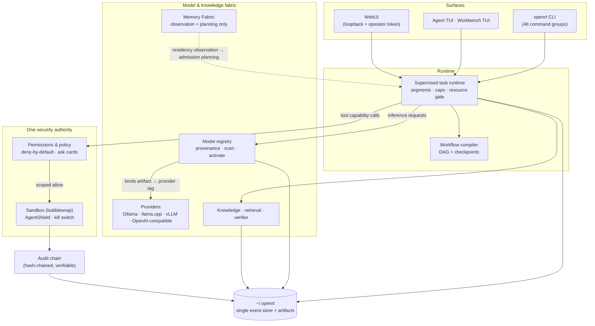

# OpenRT

**Sovereign, local-first agentic AI runtime for Linux.**

One store. One permission gate. One audit chain — agents, tools, knowledge,
workflows, and sandboxed execution on hardware you control. Bind a local
model provider, and your weights, prompts, and files never leave the
machine.

[](LICENSE)
[](https://github.com/0xhroot/openrt/releases/tag/v1.0.0-archive)
[](#known-limitations)
[](Cargo.toml)

> **V1 status — frozen reference release.** The complete V1 codebase is
> published at tag
> [`v1.0.0-archive`](https://github.com/0xhroot/openrt/releases/tag/v1.0.0-archive)
> and is frozen; later commits in this repository are documentation-only.
> The binary/package version is **`0.1.0`** (`openrt --version`); the GitHub
> archive release is **`v1.0.0-archive`**. OpenRT V2 is planned separately
> and is **not** present in this repository. The repository itself is *not*
> formally archived on GitHub — it remains browsable and issue-open.

**Who this is for:** engineers and labs that need on-premise agent autonomy —
air-gapped environments, factories, research machines — and are willing to
operate a real permission model instead of granting agents ambient authority.

**What demonstrably works:** a supervised agent loop with native tool calls
against a real local Ollama model, a deny-by-default permission gate with
operator cards, a tamper-evident audit chain, checkpointed pause/resume/recover,
hybrid retrieval that fails closed, and an honest `openrt doctor` posture
report — **2,590 tests passing**, gates and caveats recorded in
[docs/RELEASE_AUDIT.md](docs/RELEASE_AUDIT.md).

---

## Table of contents

- [Screenshots](#screenshots)
- [Quick start](#quick-start)
- [Features and validation status](#features-and-validation-status)
- [Architecture](#architecture)
- [Installation and configuration](#installation-and-configuration)
- [Models and provider binding](#models-and-provider-binding)
- [Agent, tools, security, recovery](#agent-tools-security-recovery)
- [Testing and verification](#testing-and-verification)
- [Known limitations](#known-limitations)
- [Documentation](#documentation)
- [Repository structure](#repository-structure)
- [Security and responsible use](#security-and-responsible-use)
- [License and contribution policy](#license-and-contribution-policy)
- [OpenRT V2](#openrt-v2)

## Screenshots

Real captures of the running binary on the development host — Agent Mode
TUI bound to a live local Ollama provider (`llama3.1:8b`) after a completed
first-run setup. No mock UI, no stock images.

**Main chat — a completed tool-use task with live status rails**


| Permission gate | Models and provider status |
|:---:|:---:|
|  |  |
| <sub>The model asked for a file write; the operator scopes the grant (once / session / workspace).</sub> | <sub>Live provider probe, honest resource-fit row, curated offline catalog.</sub> |

| Task completion | Workbench timeline |
|:---:|:---:|
|  |  |
| <sub>Tool result, agent answer, audit-linked status bar.</sub> | <sub>Sessions, tasks, and the live Ops event timeline.</sub> |

## Quick start

Prerequisites: **Linux x86_64**, Rust **1.89+**, and (for a real provider)
[Ollama](https://ollama.com) on loopback. Optional extras: `bubblewrap`
(sandbox), `nvidia-smi` (VRAM probes), LibreOffice (PDF export).

```console
git clone https://github.com/0xhroot/openrt.git
cd openrt
cargo build --release

ollama pull llama3.1:8b          # any local chat model
ollama list                      # confirm what Ollama actually has

./target/release/openrt doctor   # honest posture report: PASS/WARN/UNAVAILABLE/FAIL
./target/release/openrt model list
./target/release/openrt          # Agent TUI — first run opens the setup wizard
```

The **first-run wizard** probes the provider with a real transport call,
shows the advertised tool schema and context window, and binds a model
before anything is persisted. Useful next commands:

```console
./target/release/openrt tui            # Workbench TUI: sessions · tasks · ops
./target/release/openrt webui serve    # loopback web workbench (operator token)
./target/release/openrt mode status    # Sovereign / Provisioning (ADR-003)
./target/release/openrt audit verify   # check the audit hash chain
./target/release/openrt sih demo --json  # hermetic demo, mock backend, ~1 s
```

**Where state lives.** Everything durable is under `~/.openrt/` (config,
event store, registry, audit log, sessions). Nothing is written elsewhere.
Global flags override without editing files: `--memory` (ephemeral in-memory
store), `--mock` (deterministic mock provider, no network), `--log debug`.

**Generation settings** are validated on load — invalid ranges are rejected,
not ignored. Example `~/.openrt/config.json` fragment (see
`openrt config show` for the full effective document):

```json
{
  "runtime": {
    "generation": {
      "temperature": 0.2,
      "max_tokens": 1024,
      "context_window": 8192
    },
    "agent_context_guard_ratio": 0.7
  }
}
```

Three different things, deliberately kept apart:

| Concept | Meaning |
|---|---|
| **Requested context** | `generation.context_window` — forwarded verbatim to the provider when supported (Ollama `num_ctx`). `null` = provider default. |
| **Effective context** | What the provider actually advertises. A request above the provider's certified maximum is **refused**, never silently downgraded. The agent's working budget is `effective window × agent_context_guard_ratio` (default 0.7); older turns are compacted with an honest marker, and a single request that alone exceeds the budget is refused. |
| **Resource feasibility** | Separate admission question: real RAM/VRAM headroom vs configured floors (`openrt model compatibility` is observation-only — it never fabricates hardware measurements). |

## Features and validation status

Status vocabulary (used exactly, nowhere stronger than the evidence):

| Status | Meaning |
|---|---|
| **Implemented** | Code complete in this repository |
| **Mock-tested** | Exercised by the deterministic unit/integration suite |
| **Real-provider verified** | Additionally exercised against real local Ollama on the dev host |
| **Experimental** | Implemented, limited validation |
| **Not validated** | Known gap — see [Known limitations](#known-limitations) |

| Area | What you get | Status |
|---|---|---|
| Agent runtime | Multi-segment supervised tasks, wall-clock/iteration caps, resource-gated admission, cooperative pause/resume, durable segment checkpoints, `task resume` / `task resume-task` / `recovery resume` | Mock-tested · Real-provider verified\* |
| Tool calling | Native provider tool schemas (Ollama), strict tool-call parsing, ask/allow/deny permission cards (once / session / workspace) | Mock-tested · Real-provider verified |
| Model registry | SHA-256 provenance by reference (ADR-001), curated offline library, install → scan → activate lifecycle, live provider probes | Mock-tested (lifecycle) · Real-provider verified (probe/bind) |
| Sandbox & security | Bubblewrap sandbox authority, AgentShield detectors, kill switch (ADR-008), encrypted secrets at rest, default-deny egress (netpol), tamper-evident audit log (ADR-002) | Mock-tested |
| Knowledge / RAG | Content-inspected ingest, hybrid BM25+dense retrieval with citations, evidence graph with trust labels, injection detection, hallucination firewall — answers fail closed | Mock-tested |
| Workflows | Natural-language goal → compiled DAG, checkpoints after every durable node, resume/retry/skip/dry-run recovery | Mock-tested |
| Surfaces | Agent TUI (chat-first), Workbench TUI, loopback WebUI with operator token, 46-group CLI | Mock-tested |
| Sovereign mode | Fail-closes external network at every scope (browser, DB, MCP, **remote models**, telemetry); loopback + files stay local; every refusal audited with a fix hint (ADR-003) | Mock-tested · Real-provider verified |
| Memory Fabric | Residency observation, model-anatomy metadata, pure tier **planning** (proposal only — see [Architecture](#architecture)) | Mock-tested |
| Streaming | Token streaming for Ollama, gated behind an explicitly configured idle timeout | **Not validated** end-to-end |
| Context compaction | Request-budget guard + honest compaction marker in the agent request path | **Not validated** live (guard unit-tested) |
| Domains | Industrial intelligence (advisory RCA/FMEA), research-only trading backtests — `execute` always refuses; no order path exists | Mock-tested · advisory/research only |

\* Real-provider pause/resume was verified via the integration test
`real_ollama_pause_then_resume_preserves_transcript` against real Ollama —
an API-level supervised pause, not an interactive TUI keystroke under live
generation.

## Architecture



Design invariants, held across every phase:

1. **One store** — sessions, tasks, registry, audit, and knowledge hang off a
   single event-log store (ADR-006: references + digests, never copies).
2. **One gate** — every tool, browser, DB, MCP, and computer-use call passes
   the same deny-by-default permission authority.
3. **One audit chain** — append-only, hash-chained, verifiable
   (`openrt audit verify`).
4. **Honest failure** — capabilities that cannot be probed report
   `UNAVAILABLE`; nothing invents a greener second answer.

**Memory Fabric, stated precisely.** Memory Fabric is a
**resource-observation and planning layer**: residency snapshots from
`/proc`, bounded model-anatomy metadata (header-only reads), and a pure
tier-planning function (`MemoryPlan` proposes; `ResourceGate` authorizes).
OpenRT does **not** load weights, memory-map tensors, stream pages, offload
layers, or manage KV caches — that is provider-backend territory. Tiered
execution performed by OpenRT itself (milestone M13) is deliberately
unimplemented; see [MEMORY_FABRIC.md](docs/architecture/MEMORY_FABRIC.md).

## Installation and configuration

See [Quick start](#quick-start) for the short path. Details:

- **Toolchain** — Rust 1.89+ (workspace `rust-version`); Linux x86_64
  glibc. Windows/macOS: untested, no claim made.
- **Offline builds** — once the cargo registry cache is primed,
  `cargo build --release --offline` works; the workspace needs no network.
- **Config discovery** — `OPENRT_CONFIG` env var, else `openrt.json` in
  the working directory when present, else `~/.openrt/config.json`
  (created on first run). Inspect the merged result with `openrt config
  show` (JSON). Unknown fields and out-of-range values are rejected at
  load.
- **Providers** — configured under `providers[]` (id, kind, base_url,
  default_model). The default is `ollama` at `http://127.0.0.1:11434`.
- **Sovereign vs Provisioning** — `openrt mode status`. Sovereign
  fail-closes external network before any socket is opened; Provisioning
  allows curated network operations (e.g. `model search --hf`).

## Models and provider binding

OpenRT never conflates four different identities:

1. **Discovery** — `openrt model search` walks the curated offline library
   and installed registry (offline). `--hf` additionally queries Hugging
   Face and is refused in Sovereign mode before any socket.
2. **Registration / installation** — `openrt model register <path>` records
   a local artifact **by reference** (streamed SHA-256, header inspection,
   path recorded — never a byte copied). `openrt model install` imports,
   verifies, publishes the immutable manifest (ADR-001), and runs the scan
   gate.
3. **Activation** — `Scanned → Active` makes an artifact routable.
   Operator-only, audited.
4. **Provider binding** — `openrt model bind` maps an artifact to a
   **provider tag** (e.g. `llama3.1:8b`). Artifact digest, registry card,
   provider endpoint, and tag are four separate fields; the UI keeps them
   apart.

**An Ollama model you installed is not automatically an OpenRT-registered
artifact.** `ollama pull` makes a tag available to the provider; registering
the same weights in OpenRT is a separate, provenance-recording step. You can
run purely against provider tags without registering anything — registration
exists for audit and supply-chain rigor, not as a hidden prerequisite.

Lifecycle: `Registered → Installed → Scanned → Active`, with signed offline
scan bundles.

## Agent, tools, security, recovery

- **Execution model** — a task is a sequence of supervised agent segments
  against one session. Every segment checkpoints durably; turn state inside
  a segment is working state. Iteration, wall-clock, tool-call, and turn
  caps are enforced by the supervisor.
- **Resource gate** — before admission, real headroom (RAM, VRAM via
  `nvidia-smi`, CPU load) is probed against configured floors; tight systems
  get bounded retries then a structured denial — never a surprise OOM.
- **Permissions** — tools declare capabilities; policy maps each to
  `allow` / `ask` / `deny` (or hides it). `ask` renders an operator card
  with scope choices: once, this session, this workspace. Deny leaves the
  world untouched and tells the model honestly.
- **Sandbox** — `python.run` and friends execute confined (bubblewrap),
  workspace-jailed, shield-scanned.
- **Pause / resume / recover** — cooperative in-process pause writes a
  durable `Paused` segment outcome; `task resume-task` continues a paused
  agent, `task resume` continues a workflow checkpoint chain, and
  `recovery resume` re-enters an interrupted task after a crash from the
  last durable segment. Transcripts are never re-run from scratch.
- **Kill switch** — operator halt (ADR-008) is immediate and audited.

## Testing and verification

All gates were run **manually on the development host** (no CI — see
limitations). Latest evidence, 2026-10-10, also recorded in
[docs/RELEASE_AUDIT.md](docs/RELEASE_AUDIT.md) §7:

```console
cargo fmt --all -- --check           # exit 0, clean
cargo check --offline --workspace    # exit 0
cargo clippy --workspace --all-targets --offline
    # exit 0, 0 errors, 443 warnings summed across all targets
    # (~182 unique diagnostics after cross-target duplicates; largest
    #  class: clippy::await_holding_lock). No -D warnings gate exists.
cargo test --offline --workspace     # 2590 passed · 0 failed
openrt doctor                        # 86 PASS · 13 UNAVAILABLE · 0 FAIL · 2 WARN
```

Real-provider verification (Ollama on loopback), stated precisely:

- **Multi-turn native tool calling** — supported for `llama3.1:8b`
  (round-tripped tool calls across exchanges); documented as *not* universal
  across models (`qwen2.5-coder:7b` emits prose JSON — classified honestly,
  never executed). See
  [REAL_HARNESS_ACCEPTANCE.md](docs/architecture/REAL_HARNESS_ACCEPTANCE.md).
- **Pause/resume** — integration test
  `real_ollama_pause_then_resume_preserves_transcript` passed against real
  Ollama (supervised API-level pause, not an interactive TUI pause under
  live generation).
- **Provider probe, tool-schema advertisement, resource admission probes** —
  exercised live (Models screenshot above).
- **Streaming** — implemented, **not measured** end-to-end; the acceptance
  battery used non-streaming `/api/chat`. Treat streaming as unverified.
- **Live context compaction** — **not demonstrated** against a real
  provider this cycle; the guard and marker are unit-tested.

Per-phase acceptance records (test matrices, red-team results, measured
performance): [docs/](docs/README.md).

## Known limitations

Stated plainly, because a green checkmark you can't audit is worthless:

- **Streaming not validated end-to-end** — implemented for Ollama but only
  active with an explicitly configured idle timeout; a stream can end
  without a terminal `done` frame and the client surfaces an honest error
  instead of pretending the answer completed. Non-streaming paths are the
  validated ones.
- **Live context compaction not demonstrated** — the budget guard and
  compaction marker are implemented and unit-tested; no real-provider run
  showed compaction this cycle.
- **No CI** — every gate above was run by hand on one Linux host. Reproduce
  them; don't trust them blindly.
- **443 Clippy warnings (ungated)** — pre-existing; no `-D warnings` policy
  is configured.
- **Linux x86_64 only** — sandbox and computer-use paths are Linux-specific
  (Wayland/Hyprland backend exercised). No Windows/macOS claim.
- **`openrt doctor` is a posture report, not an audit suite** — 13 rows are
  honestly `UNAVAILABLE` on a typical minimal host (optional tooling such
  as whisper ASR); its supply-chain row is a **lockfile integrity check**
  (Cargo.lock resolved and pinned), not a dependency vulnerability or
  license audit.
- **Memory Fabric does not move memory** — observation and planning only;
  no weight loading, mmap, offload, or KV management is performed by OpenRT
  (see [Architecture](#architecture)).
- **Domains are advisory / research-only** — trading has no broker and no
  order path (`execute` refuses by design); industrial outputs are advisory.

## Documentation

Start at **[docs/README.md](docs/README.md)** — the full index grouped by
architecture, agent execution, Memory Fabric, security, providers,
milestone reports, testing, and limitations. Key entry points:

- [Final architecture](docs/architecture/phase13/FINAL_ARCHITECTURE.md)
- [Security threat model](docs/architecture/phase13/SECURITY_THREAT_MODEL.md)
- [Phase 13 acceptance & test matrix](docs/architecture/phase13/PHASE13_ACCEPTANCE.md)
- [Real-provider harness acceptance](docs/architecture/REAL_HARNESS_ACCEPTANCE.md)
- [Memory Fabric design](docs/architecture/MEMORY_FABRIC.md)
- [ADRs 001–010](docs/architecture/adr/)
- [Release audit (V1 preflight)](docs/RELEASE_AUDIT.md)
- [Archive release v1.0.0-archive](https://github.com/0xhroot/openrt/releases/tag/v1.0.0-archive)

## Repository structure

```
openrt/
├── Cargo.toml              # workspace: 64 crates, rust-version 1.89
├── LICENSE                 # MIT
├── README.md               # this file
├── crates/                 # all source (core → runtime → fabric → surfaces)
│   ├── openrt-core/        # config, events, store, redaction
│   ├── openrt-runtime/     # supervised task runtime
│   ├── openrt-tui/         # Agent + Workbench TUIs
│   ├── openrt-cli/         # the `openrt` binary
│   └── … 60 more
└── docs/
    ├── README.md           # documentation index (start here)
    ├── RELEASE_AUDIT.md    # V1 preflight: scans, gates, staging, licensing
    ├── architecture/       # ADRs + per-phase implementation & acceptance
    ├── milestone-reports/  # phase gate decisions + master plan
    ├── roadmap/            # ROADMAP.md
    └── assets/screenshots/ # genuine captures of the running app
```

## Security and responsible use

- OpenRT is an **operator-controlled runtime**. It will drive a browser,
  write files, and run code — through the permission gate, inside the
  sandbox, on the audit chain. Review `openrt policy` and the default `ask`
  posture before widening any scope.
- The trust boundary is **your hardware** *when you bind local providers*.
  A remote OpenAI-compatible endpoint is a supported transport, but then
  prompts and inference leave the machine — sovereignty is a property of
  the provider binding, not a promise OpenRT can make about someone else's
  API.
- Run it like any agent with real machine access: dedicated user, minimal
  filesystem scope, Sovereign mode for network isolation.
- **Vulnerability reports:** please open a GitHub security advisory (or a
  private issue referencing it) rather than a public issue with exploit
  details. Do not include real secrets or production data in reports.

## License and contribution policy

MIT — see [LICENSE](LICENSE). All 64 workspace crates declare
`license = "MIT"` via workspace inheritance. Dependencies are pinned in
`Cargo.lock` (403 packages); the full dependency-license inventory is in
[docs/RELEASE_AUDIT.md](docs/RELEASE_AUDIT.md) §5 (all permissive; run
`cargo deny check licenses` before any binary distribution — the tool was
not available on the release host).

V1 code is **frozen**. Contributions that help are: issues that reproduce
against `cargo test --offline --workspace` and `openrt doctor` on a clean
`~/.openrt`, and documentation corrections via PR. Feature work belongs to
V2.

## OpenRT V2

V1 is the frozen reference: the full sovereign agentic runtime with its
gates, gaps, and evidence published in the open. V2 is planned separately —
expect a re-baselined core (cleaner crate graph, V1 lessons baked in as
invariants), CI from day one, and the streaming/compaction gaps above closed
with real-provider integration tests. **No V2 code lives in this
repository.** Watch the repository for the V2 roadmap when it lands.
